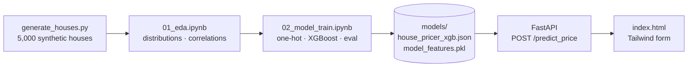

# DreamHouse AI

> Predicts the construction cost of a house from its parameters — area, floors, material, distance to the city, pool, landscaping. A small project that walks the full ML lifecycle: **data generation → EDA → training → evaluation → API → web UI**.


---

## Pipeline



## Results

| Metric | Value (test set, 1,000 houses) |
|---|---|
| R² | **0.964** |
| MAE | **$13,128** |

**How good is that?** The generator adds Gaussian noise with σ = $15,000 to every price. The expected absolute value of that noise alone is σ·√(2/π) ≈ **$12,000** — the irreducible error no model can beat. An MAE of $13.1k means the model is within ~$1.1k of the noise floor: it learned almost all of the real signal and is not overfitting to noise.

## Data

The dataset is synthetic, generated with explicit pricing rules (seeded, reproducible):

| Feature | Effect on price |
|---|---|
| `area_sqm` (50–500) × material | $400/m² aerated block · $600/m² brick · $800/m² wood |
| `has_pool` | +$25,000 (more likely for houses > 150 m²) |
| `has_landscape` | +$10,000 |
| `floors > 1` | +$15,000 (stairs, floor slabs) |
| `distance_city_km` | −$200 per km |
| noise | N(0, $15,000), price floored at $10,000 |

Because the true rules are known, the model can be checked against ground truth — EDA in `01_eda.ipynb` confirms the expected ordering (wood > brick > aerated block) and the dominance of area in the correlation matrix.

## Engineering details

- **Feature alignment at inference.** The column order from training is saved to `model_features.pkl`; the API one-hot encodes the request and adds any missing material columns as zeros, so a single request always matches the training schema.
- **Portable model format.** The model is saved with XGBoost's native JSON format instead of pickle, so it loads across platforms and library versions; it's loaded back through `XGBRegressor` so `base_score` is restored.
- **Safety floor** — predictions are clamped at $10,000, matching the data generator.

## Run locally

```bash
python3 -m venv .venv && source .venv/bin/activate
pip install -r requirements.txt jupyter matplotlib seaborn

cd generator && python generate_houses.py && cd ..     # → data/raw/houses_dataset.csv
# optional: re-train by running notebooks/02_model_train.ipynb (a trained model is already in models/)

cd backend && uvicorn main:app --reload
```

Open **http://127.0.0.1:8000** — the API serves the web UI at `/`. Swagger: http://127.0.0.1:8000/docs.

```bash
curl -X POST http://127.0.0.1:8000/predict_price -H "Content-Type: application/json" -d '{
  "area_sqm": 180, "rooms": 5, "floors": 2, "distance_city_km": 15,
  "has_pool": 1, "has_landscape": 0, "material": "Brick"
}'
```

`material`: `Wood` · `Brick` · `Aerated_block`

## Project structure

```
DreamHouse_AI/
├── generator/generate_houses.py   # synthetic dataset
├── notebooks/
│   ├── 01_eda.ipynb               # exploratory analysis
│   └── 02_model_train.ipynb       # training, evaluation, export
├── models/
│   ├── house_pricer_xgb.json      # trained XGBoost model
│   └── model_features.pkl         # training column order
├── backend/main.py                # FastAPI: /predict_price, serves the UI
└── frontend/index.html            # web form
```

## Next steps

- Cross-validation and a baseline (linear regression) to show what boosting adds
- Feature importance / SHAP explanations in the UI
- Train on real construction-cost data
